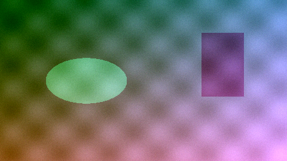
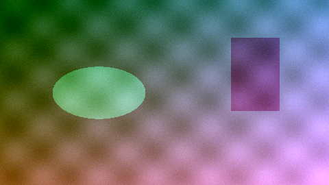

# Benchmark

CPU numbers below are from dedicated GCP Spot VMs in Tokyo (`asia-northeast1`) on 2026-11-20. They replace the earlier shared-VM and GitHub Actions tables as the primary result. Each table is one pass. A gap of a few percent is one sample, not a settled ordering.

Fps columns, left to right, are libvmx (official), vmx-codec (Saul), and vmx. The x86-64 tables insert libvmx 128-bit after the AVX2 column. Every comparison table ends with a Fastest column naming the winner on that row (`libvmx`, `libvmx 128-bit`, `vmx-codec`, `vmx`, or, in the wgpu table, the path name). **Bold** is that winner's value; a tie bolds each tied value and lists every name. In the fps tables the winner is the highest median. In the ratio tables the winner is the highest geometric mean of fps over the rows in that line; libvmx's ratio is 1 and is not printed, and the winner's ratio cell is bold when the winner is vmx or vmx-codec. The profile cell is the OMT name, the sender's quality name, and the fixed q, as in `OMT_HQ — High (96)`. `✗` is a median below 60 fps.

| Implementation | Commit / version | What was timed |
|---|---|---|
| [libvmx](https://github.com/openmediatransport/libvmx) | `31724bb96530325a989bc157c8e07538d6f1c4db` | Official C++ codec |
| [vmx-codec](https://github.com/Saul-Punybz/open-media-transport) | `fbde53cccabb1ebfff7ba773a72510ab48a64f3a` (`crates/vmx-codec`) | Pure Rust codec by Saul González |
| vmx (this repository) | 0.2.1 | Pure Rust codec |

Raw rows are in [`bench/results/`](bench/results/). The harness is [`bench/`](bench/).

## Environment

| Machine | CPU | OS and compilers |
|---|---|---|
| `c4-standard-8` Spot, asia-northeast1-b | Intel Xeon Platinum 8581C (Emerald Rapids), 2.3 GHz, 8 vCPU = 4 cores × 2 SMT, AVX2 and AVX-512, 29 GB | Debian 12, kernel 6.1, rustc 1.100.0, Debian clang 14.0.6 |
| `c4a-standard-8` Spot, asia-northeast1-b | Google Axion (Neoverse-V2), 8 cores, no SMT, NEON and SVE2, 31 GB | Debian 12 arm64, kernel 6.1, rustc 1.100.0, Debian clang 14.0.6 |
| `g2-standard-4` Spot, asia-northeast1-c | Intel Xeon at 2.20 GHz (Cascade Lake), 4 vCPU, plus NVIDIA L4 24 GB | Ubuntu 24.04.5, kernel 7.0, driver 580.178.04, Vulkan 1.4.312, rustc 1.100.0, clang 18.1.3 |

libvmx on these Debian 12 machines is clang 14.0.6 with the flags from `build/buildlinuxx64.sh` (`-O3 -std=c++17 -fdeclspec -mlzcnt -mavx2 -mbmi` on x86-64; the ARM line has no AVX flags). The earlier shared-VM and GitHub Actions runs compiled libvmx with clang 19.1.7. Do not read an fps difference between those hosts and these as a compiler-only or CPU-only change.

On the c4, vmx reported `dct=Avx2` and `color=Avx2`. vmx-codec is compile-time SSE2. On the c4a, libvmx is the sse2neon path (one column), vmx-codec is compile-time NEON, and vmx reported `dct=Neon` and `color=Neon`. Rust crates use this repository's release profile (opt-level 3, thin LTO, one codegen unit). libvmx is `-O3` per translation unit, without link-time optimization.

## Method

`bench` fetches libvmx at the commit above and depends on vmx-codec at the commit above.

- Pictures: 1920×1080 and 3840×2160, 8-bit UYVY, progressive. `natural` and `bars` are in [`bench/images/`](bench/images/) (gzip of the UYVY frames, SHA-256 of the uncompressed bytes, and 480×270 PNG previews).
- Profiles: only OMT_LQ, OMT_SQ, and OMT_HQ. See below.
- Quality: libvmx rate control runs for 60 frames on that picture. The settled `q` is then fixed, and every timed encode calls set-quality with that `q`. DC shift and minimum quality stay at the profile defaults.
- Encode is colour conversion, coding, and serialize. Decode is load plus decode to UYVY. Every decoder receives the same packet, produced by libvmx's 128-bit path at the fixed `q`.
- Buffers are allocated before the timer. Three warmup frames, then seven runs of at least 0.3 s. The table value is the median.
- Threads: 1 and 8. On the c4, 8 threads is two per core (SMT). On the c4a, 8 threads is one per core.

| 1080p natural | 1080p bars | 2160p natural | 2160p bars |
|---|---|---|---|
|  |  |  |  |

Every row in [`gcp-x86-c4.csv`](bench/results/gcp-x86-c4.csv) (192) and [`gcp-arm-c4a.csv`](bench/results/gcp-arm-c4a.csv) (144) matched the libvmx 128-bit packet on encode and its pixels on decode. `bytes/frame` is that size. 10-bit P216 and PA16 are not in the matrix: `vmx` 0.2.1 returns `invalid parameters` from those entry points.

## Profiles

The constants are the `VMX_PROFILE` enum in official libvmx `31724bb`, [`src/vmxcodec.h` lines 76–84](https://github.com/openmediatransport/libvmx/blob/31724bb96530325a989bc157c8e07538d6f1c4db/src/vmxcodec.h#L76-L84). libomtnet mirrors those six values in `VMXProfile` ([`src/codecs/OMTVMX1Codec.cs` lines 43–53](https://github.com/openmediatransport/libomtnet/blob/7d29031ff3f355ffa1f0cd08ee24d02e258445dd/src/codecs/OMTVMX1Codec.cs#L43-L53), commit `7d29031`). `OMTSend.CreateCodec` ([`src/OMTSend.cs` lines 511–518](https://github.com/openmediatransport/libomtnet/blob/7d29031ff3f355ffa1f0cd08ee24d02e258445dd/src/OMTSend.cs#L511-L518)) selects only the OMT profiles: `OMTQuality.Low` → `OMT_LQ` (133), `Medium` → `OMT_SQ` (166), `High` → `OMT_HQ` (199). The codec constructor replaces `VMXProfile.Default` with `OMT_SQ` ([`OMTVMX1Codec.cs` line 105](https://github.com/openmediatransport/libomtnet/blob/7d29031ff3f355ffa1f0cd08ee24d02e258445dd/src/codecs/OMTVMX1Codec.cs#L105)). LQ, SQ, and HQ (33, 66, 99) are in the same enum. That sender does not select them.

`VMX_BITRATE_TABLE` in `src/vmxcodec_common.h` supplies the row for the picture height. The byte window is `VMX_CalculateBitrate`: `target / (60 × 8) × 1048576`, then ×0.95 and ×1.05, truncated to an integer. DC shift 0 keeps an 11-bit DC coefficient and 3 keeps 8 bits. The OMT quality floor is `VMX_OMT_MINQ` (52). The ceiling is `VMX_MAXQ` (98). `VMX_SetQuality` overrides the bitrate step for that frame and does not change the DC shift. The harness pinned q after 60 frames of rate control and set the thread count itself, so the default thread count below is not the thread count in the fps tables.

### Height 1080

| Profile | OMT quality | Target | Byte window | DC shift | Minimum quality | Default threads |
|---|---|---:|---:|---|---:|---:|
| OMT_LQ | Low | 86 Mbit/s | 178,476–197,263 | 3 (8-bit DC) | 52 | 2 |
| OMT_SQ | Medium | 200 Mbit/s | 415,061–458,751 | 0 (11-bit DC) | 52 | 2 |
| OMT_HQ | High | 260 Mbit/s | 539,579–596,377 | 0 (11-bit DC) | 52 | 2 |

### Height 2160

| Profile | OMT quality | Target | Byte window | DC shift | Minimum quality | Default threads |
|---|---|---:|---:|---|---:|---:|
| OMT_LQ | Low | 200 Mbit/s | 415,061–458,751 | 3 (8-bit DC) | 52 | 4 |
| OMT_SQ | Medium | 300 Mbit/s | 622,592–688,128 | 3 (8-bit DC) | 52 | 4 |
| OMT_HQ | High | 600 Mbit/s | 1,245,184–1,376,256 | 0 (11-bit DC) | 52 | 4 |

At 1080, Low uses an 8-bit DC and a lower target than Medium and High, which both keep an 11-bit DC. At 2160, Low and Medium use an 8-bit DC and High keeps 11 bits. Every settled q in the fps tables is 92, 94, 95, 96, or 98, above the floor of 52, so the floor did not clamp the timed frames. The DC shift still applies at that fixed q.

## Realtime (1080p60 / 2160p60)

60 fps is one frame interval. The figure is the codec call only.

On the c4, 1080p is above 60 fps for all three implementations, both images, encode and decode, at 1 and 8 threads. The lowest 1080p median is vmx-codec, OMT_HQ, natural, decode, 1 thread, at 122 fps. 2160p at 8 threads is also above 60 fps; the lowest is vmx-codec, OMT_HQ, natural, encode, at 131 fps. At 2160p and 1 thread, vmx-codec encode is below 60 fps on every row (45–59 fps), and its OMT_HQ natural decode is 56 fps. libvmx and vmx stay above 60 fps on every 2160p encode and decode row.

On the c4a, 1080p is above 60 fps on every row. The lowest is vmx, OMT_HQ, natural, decode, 1 thread, at 128 fps. 2160p at 8 threads is above 60 fps; the lowest is libvmx, OMT_HQ, natural, encode, at 164 fps. At 2160p and 1 thread, natural encode is below 60 fps for all three. Colour-bar encode is below 60 fps for libvmx (58) and vmx (54); vmx-codec is at 61–62 fps. OMT_HQ natural decode is below 60 fps for vmx-codec (58) and vmx (50); libvmx is at 62 fps. The other 1-thread 2160p decode rows are above 60 fps.

## Relative to libvmx

Geometric mean of `median / libvmx` over the 12 rows of that operation and thread count (3 profiles × 2 images × 2 resolutions). The range is the smallest and largest ratio. On x86-64, libvmx is the AVX2 column. On ARM, libvmx is the only official column (sse2neon).

### c4-standard-8 (4 cores, SMT)

| Operation | Threads | vmx / libvmx | vmx-codec / libvmx | Fastest |
|---|---:|---:|---:|---|
| Encode | 1 | 0.75 (0.68–0.82) | 0.38 (0.32–0.46) | libvmx |
| Encode | 8 | **1.09 (0.97–1.28)** | 0.32 (0.25–0.42) | vmx |
| Decode | 1 | 0.73 (0.55–1.00) | 0.52 (0.43–0.63) | libvmx |
| Decode | 8 | **1.03 (0.75–1.43)** | 0.33 (0.18–0.60) | vmx |

vmx / libvmx by image. Fastest is still over every implementation, so a bold ratio means vmx is ahead of libvmx, vmx-codec, and, on x86-64, libvmx 128-bit.

| Operation | Threads | natural | bars | Fastest (natural) | Fastest (bars) |
|---|---:|---:|---:|---|---|
| Encode | 1 | 0.75 (0.68–0.82) | 0.74 (0.74–0.75) | libvmx | libvmx |
| Encode | 8 | **1.16 (1.02–1.28)** | **1.03 (0.97–1.08)** | vmx | vmx |
| Decode | 1 | 0.91 (0.86–1.00) | 0.59 (0.55–0.62) | libvmx | libvmx 128-bit |
| Decode | 8 | **1.31 (1.19–1.43)** | 0.81 (0.75–0.86) | vmx | libvmx 128-bit |

Eight threads here share four cores. The 8-thread encode mean of 1.09 is much closer to libvmx than the same ratio on the 8-core c4a below. vmx-codec's SSE2 path is also behind libvmx's 128-bit path on this machine (geometric mean 0.58, 0.48, 0.54, and 0.35 for encode 1 thread, encode 8, decode 1, and decode 8). Several 8-thread colour-bar decode rows are higher for the 128-bit path than for AVX2 libvmx or vmx; those cells are the bold ones.

### c4a-standard-8 (8 cores)

| Operation | Threads | vmx / libvmx | vmx-codec / libvmx | Fastest |
|---|---:|---:|---:|---|
| Encode | 1 | 0.94 (0.93–0.97) | **1.07 (1.05–1.09)** | vmx-codec |
| Encode | 8 | **1.85 (1.76–1.94)** | 1.66 (1.59–1.79) | vmx |
| Decode | 1 | 0.74 (0.66–0.83) | 0.76 (0.60–0.97) | libvmx |
| Decode | 8 | **1.40 (1.16–1.64)** | 0.80 (0.45–1.44) | vmx |

vmx / libvmx by image:

| Operation | Threads | natural | bars | Fastest (natural) | Fastest (bars) |
|---|---:|---:|---:|---|---|
| Encode | 1 | 0.95 (0.93–0.97) | 0.93 (0.93–0.93) | vmx-codec | vmx-codec |
| Encode | 8 | **1.82 (1.76–1.90)** | **1.87 (1.78–1.94)** | vmx | vmx |
| Decode | 1 | 0.80 (0.78–0.83) | 0.68 (0.66–0.71) | libvmx | libvmx |
| Decode | 8 | **1.59 (1.53–1.64)** | **1.23 (1.16–1.28)** | vmx | vmx |

The 1-thread encode ratios sit in a band of a few percent. The within-run spread on this machine is usually well under that (median `(max − min) / median` about 0.3%). vmx-codec's 8-thread decode mean of 0.80 is pulled down by colour bars (0.45–0.48); on natural images that ratio is 1.39 (1.30–1.44).

## x86-64 — c4-standard-8

Xeon Platinum 8581C, 4 cores / 8 threads. 192 rows, all byte-identical to libvmx 128-bit. CSV: [`bench/results/gcp-x86-c4.csv`](bench/results/gcp-x86-c4.csv).


### Encode, 1 thread

| Resolution | Profile | Image | bytes/frame | libvmx | libvmx 128-bit | vmx-codec | vmx | Fastest |
| --- | --- | --- | ---: | ---: | ---: | ---: | ---: | --- |
| 1080p | OMT_LQ — Low (92) | natural | 168,577 | **451** | 305 | 194 | 353 | libvmx |
| 1080p | OMT_SQ — Medium (95) | natural | 418,883 | **360** | 238 | 160 | 247 | libvmx |
| 1080p | OMT_HQ — High (96) | natural | 559,463 | **307** | 206 | 140 | 208 | libvmx |
| 1080p | OMT_LQ — Low (98) | bars | 22,008 | **703** | 440 | 232 | 523 | libvmx |
| 1080p | OMT_SQ — Medium (98) | bars | 24,303 | **712** | 440 | 231 | 524 | libvmx |
| 1080p | OMT_HQ — High (98) | bars | 24,303 | **706** | 439 | 230 | 523 | libvmx |
| 2160p | OMT_LQ — Low (92) | natural | 595,921 | **111** | 79 | 50 ✗ | 90 | libvmx |
| 2160p | OMT_SQ — Medium (92) | natural | 595,921 | **111** | 79 | 49 ✗ | 91 | libvmx |
| 2160p | OMT_HQ — High (94) | natural | 1,192,159 | **103** | 69 | 45 ✗ | 74 | libvmx |
| 2160p | OMT_LQ — Low (98) | bars | 76,145 | **174** | 111 | 59 ✗ | 131 | libvmx |
| 2160p | OMT_SQ — Medium (98) | bars | 76,145 | **176** | 111 | 58 ✗ | 131 | libvmx |
| 2160p | OMT_HQ — High (98) | bars | 80,733 | **175** | 111 | 58 ✗ | 131 | libvmx |

### Encode, 8 threads

| Resolution | Profile | Image | bytes/frame | libvmx | libvmx 128-bit | vmx-codec | vmx | Fastest |
| --- | --- | --- | ---: | ---: | ---: | ---: | ---: | --- |
| 1080p | OMT_LQ — Low (92) | natural | 168,577 | 1409 | 957 | 488 | **1657** | vmx |
| 1080p | OMT_SQ — Medium (95) | natural | 418,883 | 1152 | 801 | 433 | **1179** | vmx |
| 1080p | OMT_HQ — High (96) | natural | 559,463 | 950 | 692 | 398 | **1010** | vmx |
| 1080p | OMT_LQ — Low (98) | bars | 22,008 | 2130 | 1364 | 544 | **2160** | vmx |
| 1080p | OMT_SQ — Medium (98) | bars | 24,303 | **2158** | 1343 | 531 | 2104 | libvmx |
| 1080p | OMT_HQ — High (98) | bars | 24,303 | 2100 | 1304 | 543 | **2132** | vmx |
| 2160p | OMT_LQ — Low (92) | natural | 595,921 | 353 | 269 | 138 | **453** | vmx |
| 2160p | OMT_SQ — Medium (92) | natural | 595,921 | 356 | 255 | 140 | **454** | vmx |
| 2160p | OMT_HQ — High (94) | natural | 1,192,159 | 328 | 237 | 131 | **377** | vmx |
| 2160p | OMT_LQ — Low (98) | bars | 76,145 | 517 | 344 | 153 | **560** | vmx |
| 2160p | OMT_SQ — Medium (98) | bars | 76,145 | 538 | 351 | 150 | **562** | vmx |
| 2160p | OMT_HQ — High (98) | bars | 80,733 | 533 | 338 | 152 | **566** | vmx |

### Decode, 1 thread

| Resolution | Profile | Image | bytes/frame | libvmx | libvmx 128-bit | vmx-codec | vmx | Fastest |
| --- | --- | --- | ---: | ---: | ---: | ---: | ---: | --- |
| 1080p | OMT_LQ — Low (92) | natural | 168,577 | **488** | 416 | 306 | 426 | libvmx |
| 1080p | OMT_SQ — Medium (95) | natural | 418,883 | **274** | 240 | 164 | 262 | libvmx |
| 1080p | OMT_HQ — High (96) | natural | 559,463 | **215** | 190 | 122 | 214 | libvmx |
| 1080p | OMT_LQ — Low (98) | bars | 22,008 | 1861 | **1933** | 826 | 1159 | libvmx 128-bit |
| 1080p | OMT_SQ — Medium (98) | bars | 24,303 | 1853 | **1996** | 826 | 1116 | libvmx 128-bit |
| 1080p | OMT_HQ — High (98) | bars | 24,303 | 1880 | **1997** | 812 | 1090 | libvmx 128-bit |
| 2160p | OMT_LQ — Low (92) | natural | 595,921 | **132** | 114 | 83 | 114 | libvmx |
| 2160p | OMT_SQ — Medium (92) | natural | 595,921 | **132** | 115 | 82 | 113 | libvmx |
| 2160p | OMT_HQ — High (94) | natural | 1,192,159 | **92** | 80 | 56 ✗ | 83 | libvmx |
| 2160p | OMT_LQ — Low (98) | bars | 76,145 | 498 | **552** | 238 | 293 | libvmx 128-bit |
| 2160p | OMT_SQ — Medium (98) | bars | 76,145 | 514 | **558** | 237 | 292 | libvmx 128-bit |
| 2160p | OMT_HQ — High (98) | bars | 80,733 | 511 | **557** | 232 | 283 | libvmx 128-bit |

### Decode, 8 threads

| Resolution | Profile | Image | bytes/frame | libvmx | libvmx 128-bit | vmx-codec | vmx | Fastest |
| --- | --- | --- | ---: | ---: | ---: | ---: | ---: | --- |
| 1080p | OMT_LQ — Low (92) | natural | 168,577 | 1538 | 1284 | 743 | **1832** | vmx |
| 1080p | OMT_SQ — Medium (95) | natural | 418,883 | 915 | 783 | 506 | **1237** | vmx |
| 1080p | OMT_HQ — High (96) | natural | 559,463 | 728 | 637 | 425 | **1042** | vmx |
| 1080p | OMT_LQ — Low (98) | bars | 22,008 | 4940 | **5265** | 952 | 4055 | libvmx 128-bit |
| 1080p | OMT_SQ — Medium (98) | bars | 24,303 | **5063** | 4843 | 936 | 3787 | libvmx |
| 1080p | OMT_HQ — High (98) | bars | 24,303 | 4745 | **5117** | 957 | 3865 | libvmx 128-bit |
| 2160p | OMT_LQ — Low (92) | natural | 595,921 | 441 | 401 | 223 | **557** | vmx |
| 2160p | OMT_SQ — Medium (92) | natural | 595,921 | 451 | 373 | 220 | **567** | vmx |
| 2160p | OMT_HQ — High (94) | natural | 1,192,159 | 308 | 264 | 184 | **427** | vmx |
| 2160p | OMT_LQ — Low (98) | bars | 76,145 | 1483 | **1585** | 323 | 1230 | libvmx 128-bit |
| 2160p | OMT_SQ — Medium (98) | bars | 76,145 | 1520 | **1592** | 318 | 1238 | libvmx 128-bit |
| 2160p | OMT_HQ — High (98) | bars | 80,733 | 1420 | **1615** | 324 | 1227 | libvmx 128-bit |

## ARM64 — c4a-standard-8

Google Axion, Neoverse-V2, 8 cores. 144 rows, all byte-identical to libvmx 128-bit. One libvmx column (sse2neon). CSV: [`bench/results/gcp-arm-c4a.csv`](bench/results/gcp-arm-c4a.csv).


### Encode, 1 thread

| Resolution | Profile | Image | bytes/frame | libvmx | vmx-codec | vmx | Fastest |
| --- | --- | --- | ---: | ---: | ---: | ---: | --- |
| 1080p | OMT_LQ — Low (92) | natural | 168,577 | 183 | **200** | 177 | vmx-codec |
| 1080p | OMT_SQ — Medium (95) | natural | 418,883 | 156 | **167** | 146 | vmx-codec |
| 1080p | OMT_HQ — High (96) | natural | 559,463 | 140 | **147** | 130 | vmx-codec |
| 1080p | OMT_LQ — Low (98) | bars | 22,008 | 230 | **243** | 215 | vmx-codec |
| 1080p | OMT_SQ — Medium (98) | bars | 24,303 | 230 | **245** | 214 | vmx-codec |
| 1080p | OMT_HQ — High (98) | bars | 24,303 | 230 | **244** | 214 | vmx-codec |
| 2160p | OMT_LQ — Low (92) | natural | 595,921 | 47 ✗ | **50 ✗** | 45 ✗ | vmx-codec |
| 2160p | OMT_SQ — Medium (92) | natural | 595,921 | 47 ✗ | **50 ✗** | 45 ✗ | vmx-codec |
| 2160p | OMT_HQ — High (94) | natural | 1,192,159 | 43 ✗ | **46 ✗** | 40 ✗ | vmx-codec |
| 2160p | OMT_LQ — Low (98) | bars | 76,145 | 58 ✗ | **61** | 54 ✗ | vmx-codec |
| 2160p | OMT_SQ — Medium (98) | bars | 76,145 | 58 ✗ | **62** | 54 ✗ | vmx-codec |
| 2160p | OMT_HQ — High (98) | bars | 80,733 | 58 ✗ | **61** | 54 ✗ | vmx-codec |

### Encode, 8 threads

| Resolution | Profile | Image | bytes/frame | libvmx | vmx-codec | vmx | Fastest |
| --- | --- | --- | ---: | ---: | ---: | ---: | --- |
| 1080p | OMT_LQ — Low (92) | natural | 168,577 | 710 | 1132 | **1282** | vmx |
| 1080p | OMT_SQ — Medium (95) | natural | 418,883 | 571 | 976 | **1056** | vmx |
| 1080p | OMT_HQ — High (96) | natural | 559,463 | 505 | 874 | **940** | vmx |
| 1080p | OMT_LQ — Low (98) | bars | 22,008 | 805 | 1309 | **1543** | vmx |
| 1080p | OMT_SQ — Medium (98) | bars | 24,303 | 814 | 1321 | **1542** | vmx |
| 1080p | OMT_HQ — High (98) | bars | 24,303 | 797 | 1308 | **1548** | vmx |
| 2160p | OMT_LQ — Low (92) | natural | 595,921 | 198 | 320 | **350** | vmx |
| 2160p | OMT_SQ — Medium (92) | natural | 595,921 | 198 | 318 | **350** | vmx |
| 2160p | OMT_HQ — High (94) | natural | 1,192,159 | 164 | 295 | **312** | vmx |
| 2160p | OMT_LQ — Low (98) | bars | 76,145 | 231 | 385 | **420** | vmx |
| 2160p | OMT_SQ — Medium (98) | bars | 76,145 | 237 | 383 | **421** | vmx |
| 2160p | OMT_HQ — High (98) | bars | 80,733 | 226 | 384 | **419** | vmx |

### Decode, 1 thread

| Resolution | Profile | Image | bytes/frame | libvmx | vmx-codec | vmx | Fastest |
| --- | --- | --- | ---: | ---: | ---: | ---: | --- |
| 1080p | OMT_LQ — Low (92) | natural | 168,577 | **315** | 306 | 246 | libvmx |
| 1080p | OMT_SQ — Medium (95) | natural | 418,883 | **191** | 173 | 155 | libvmx |
| 1080p | OMT_HQ — High (96) | natural | 559,463 | **153** | 132 | 128 | libvmx |
| 1080p | OMT_LQ — Low (98) | bars | 22,008 | **2135** | 1353 | 1518 | libvmx |
| 1080p | OMT_SQ — Medium (98) | bars | 24,303 | **2197** | 1405 | 1499 | libvmx |
| 1080p | OMT_HQ — High (98) | bars | 24,303 | **2196** | 1368 | 1512 | libvmx |
| 2160p | OMT_LQ — Low (92) | natural | 595,921 | **86** | 82 | 67 | libvmx |
| 2160p | OMT_SQ — Medium (92) | natural | 595,921 | **86** | 82 | 66 | libvmx |
| 2160p | OMT_HQ — High (94) | natural | 1,192,159 | **62** | 58 ✗ | 50 ✗ | libvmx |
| 2160p | OMT_LQ — Low (98) | bars | 76,145 | **574** | 345 | 380 | libvmx |
| 2160p | OMT_SQ — Medium (98) | bars | 76,145 | **578** | 351 | 389 | libvmx |
| 2160p | OMT_HQ — High (98) | bars | 80,733 | **577** | 345 | 379 | libvmx |

### Decode, 8 threads

| Resolution | Profile | Image | bytes/frame | libvmx | vmx-codec | vmx | Fastest |
| --- | --- | --- | ---: | ---: | ---: | ---: | --- |
| 1080p | OMT_LQ — Low (92) | natural | 168,577 | 1098 | 1423 | **1684** | vmx |
| 1080p | OMT_SQ — Medium (95) | natural | 418,883 | 699 | 964 | **1096** | vmx |
| 1080p | OMT_HQ — High (96) | natural | 559,463 | 561 | 786 | **907** | vmx |
| 1080p | OMT_LQ — Low (98) | bars | 22,008 | 5646 | 2567 | **6716** | vmx |
| 1080p | OMT_SQ — Medium (98) | bars | 24,303 | 5730 | 2600 | **6659** | vmx |
| 1080p | OMT_HQ — High (98) | bars | 24,303 | 5639 | 2532 | **6668** | vmx |
| 2160p | OMT_LQ — Low (92) | natural | 595,921 | 307 | 438 | **502** | vmx |
| 2160p | OMT_SQ — Medium (92) | natural | 595,921 | 313 | 439 | **503** | vmx |
| 2160p | OMT_HQ — High (94) | natural | 1,192,159 | 237 | 342 | **378** | vmx |
| 2160p | OMT_LQ — Low (98) | bars | 76,145 | 1789 | 856 | **2280** | vmx |
| 2160p | OMT_SQ — Medium (98) | bars | 76,145 | 1789 | 855 | **2290** | vmx |
| 2160p | OMT_HQ — High (98) | bars | 80,733 | 1790 | 860 | **2288** | vmx |

## wgpu — NVIDIA L4

`g2-standard-4` with an L4, same Tokyo day. This is `examples/gpu_bench.rs` on `vmx` 0.2.1 with `--features wgpu`, not the three-implementation harness and not the `bench/images` frames. The picture is that example's synthetic BGRA gradient. The profile is OMT_SQ, which is the sender's default. Each figure is the median of three runs; a run is the median of 60 iterations at 1080p and 30 at 2160p. CSV: [`bench/results/gcp-gpu-l4.csv`](bench/results/gcp-gpu-l4.csv).

The CPU columns are the same `vmx` build on this VM (4 vCPU, Cascade Lake, AVX2, all threads). **Bold** and Fastest follow the same rule as the other tables: the highest fps on the row. The host-pixel column does not move a texture, so it is often the fastest number and is not the same workload as the GPU path. The GPU / CPU+transfer column is that pair's ratio, not another implementation. The opaque encode has no CPU-plus-transfer measurement.

| Resolution | Operation | CPU, host pixels | CPU + texture transfer | GPU (wgpu) | GPU / CPU+transfer | Fastest |
| --- | --- | ---: | ---: | ---: | ---: | --- |
| 1080p | Decode → BGRA texture | **516 fps (1.94 ms)** | 281 fps (3.55 ms) | 478 fps (2.09 ms) | 1.70× | CPU, host pixels |
| 1080p | Preview (1/8) → texture | **1377 fps (0.73 ms)** | 1328 fps (0.75 ms) | 1190 fps (0.84 ms) | 0.90× | CPU, host pixels |
| 1080p | Encode, BGRA texture → bitstream (alpha, 4 planes) | **278 fps (3.60 ms)** | 176 fps (5.69 ms) | 183 fps (5.45 ms) | 1.04× | CPU, host pixels |
| 1080p | Encode, BGRA texture → bitstream (opaque, 3 planes) | **352 fps (2.84 ms)** | — | 262 fps (3.82 ms) | 0.74× vs host pixels | CPU, host pixels |
| 2160p | Decode → BGRA texture | **131 fps (7.64 ms)** | 71 fps (14.08 ms) | 118 fps (8.45 ms) | 1.67× | CPU, host pixels |
| 2160p | Preview (1/8) → texture | **453 fps (2.21 ms)** | 429 fps (2.33 ms) | 419 fps (2.38 ms) | 0.98× | CPU, host pixels |
| 2160p | Encode, BGRA texture → bitstream (alpha, 4 planes) | **70 fps (14.28 ms)** | 37 fps ✗ (26.70 ms) | 42 fps ✗ (23.99 ms) | 1.11× | CPU, host pixels |
| 2160p | Encode, BGRA texture → bitstream (opaque, 3 planes) | **89 fps (11.28 ms)** | — | 60 fps (16.64 ms) | 0.68× vs host pixels | CPU, host pixels |

GPU decode versus CPU decode differs by at most 3 LSB. PSNR is 54.6 dB at 1080p and 64.1 dB at 2160p (54.55 and 64.11 in the log). GPU preview and GPU encode match the CPU path bit for bit (PSNR 100 dB). Encode does colour conversion, FDCT, and quantisation on the GPU; Golomb coding stays on the CPU. Preview is the CPU `decode_preview_bgra` plus `queue.write_texture`.

The CPU-plus-transfer decode time on this VM moved between 3.5 ms and 11.5 ms at 1080p across the three runs (11.47, 3.55, 3.54; the median is 3.55). Treat that column as rough. The GPU columns were stable across the same three runs.

The first process did not see the L4. The NVIDIA Vulkan ICD failed to load (`libGLX_nvidia.so.0`), and wgpu used Mesa llvmpipe with no error from `request_headless_device()`. Installing `libnvidia-gl-580-server` and `libegl1` made the discrete L4 visible (Vulkan 1.4.312, `BGRA8UNORM_STORAGE` true). The table is that L4 run. The llvmpipe pass is not a GPU result and is not tabulated here.

## Earlier shared-runner results

These are not the primary numbers. They were taken on shared machines, and libvmx was built with clang 19.1.7 rather than the clang 14.0.6 used on the Debian 12 GCP VMs above.

- A KVM guest, Xeon Emerald Rapids, 8 vCPU and no SMT, Debian 13: [`x86-64-default.csv`](bench/results/x86-64-default.csv) (384 rows, including LQ/SQ/HQ) and a partial `target-cpu=native` pass in [`x86-64-native.csv`](bench/results/x86-64-native.csv). Repeat runs on that host moved by about 10–20%.
- GitHub-hosted `ubuntu-24.04-arm` (Neoverse-N2, 4 vCPU): [`linux-arm64.csv`](bench/results/linux-arm64.csv).
- GitHub-hosted `macos-latest` (Apple M1, virtual, 3 vCPU): [`macos-arm64.csv`](bench/results/macos-arm64.csv). Some 3-thread rows on that VM had a seven-run spread large enough that the median is a weak summary.

LQ, SQ, and HQ (ids 33, 66, 99) appear only in those older CSVs. The dedicated-machine runs did not measure them. A later GCP run limited to the OMT profiles is what this file now reports; another dedicated pass can still replace these tables.

## Reproducing

```bash
cd bench
cargo run --release > results.csv
```

`clang++`, `git`, and `ar` are required. Filters: `--res 1080`, `--prof OMT_HQ`, `--img natural`, `--threads 1`. [`bench/scripts/run_omt.sh`](bench/scripts/run_omt.sh) is the resume script from the GCP OMT-only pass. [`bench/scripts/make_tables.py`](bench/scripts/make_tables.py) turns a harness CSV into the table shape used above.
